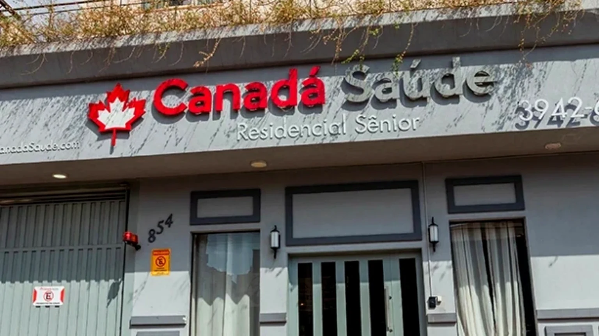

# 🍁 ConectaSênior — Canadá Residencial Sênior

<p align="center">
  
  
  
  
</p>

<p align="center">
  <strong>Tecnologia, cuidado e acolhimento em um só lugar.</strong>
</p>

<p align="center">
  Site desenvolvido para apresentar o <strong>Canadá Residencial Sênior</strong>,
  em Sertãozinho (SP), facilitando o acesso de familiares e visitantes
  às informações sobre a instituição.
</p>

<p align="center">
  
</p>

---

## Sobre o projeto

O **ConectaSênior** é um projeto de extensão do curso de **Análise e Desenvolvimento de Sistemas do SENAI**, desenvolvido em parceria com o **Canadá Residencial Sênior — Unidade Sertãozinho**, integrante do Grupo Canadá Saúde.

A proposta é criar um site que apresente a instituição de maneira clara, moderna e acolhedora, reunindo informações sobre os serviços oferecidos, a estrutura, as atividades e as formas de contato.

Ao longo do desenvolvimento, o projeto passou por diferentes versões, cada uma trazendo melhorias na aparência, na organização dos conteúdos e no funcionamento do site.

A **V3**, versão atual, trouxe fotografias dos ambientes, melhorias na navegação, novos componentes interativos e um formulário que permite o envio real de mensagens.

Nosso objetivo é que o site seja uma forma prática de conhecer melhor o residencial, ajudando familiares a encontrar informações importantes antes mesmo de realizar uma visita.

## Objetivos

O principal objetivo do projeto é facilitar o acesso às informações sobre o Canadá Residencial Sênior, oferecendo uma navegação simples e agradável.

Entre os objetivos estão:

- Apresentar os serviços, profissionais e ambientes da instituição.
- Facilitar o contato e a solicitação de visitas.
- Mostrar as atividades e os cuidados oferecidos aos residentes.
- Destacar a importância da convivência, do bem-estar e da autonomia.
- Desenvolver um site responsivo, que funcione em computadores e celulares.
- Aplicar os conhecimentos de desenvolvimento web adquiridos durante o curso em um projeto real.

## O que você encontra no site

O site foi dividido em seções para facilitar a navegação e organizar melhor as informações.

| Seção | Conteúdo |
| :--- | :--- |
| **Início** | Apresentação do residencial, fotografias e acesso ao agendamento de visitas. |
| **Nossa essência** | Informações sobre os valores, o acolhimento e os cuidados com os residentes. |
| **Cuidados e serviços** | Apresentação dos serviços e da assistência oferecida. |
| **Estrutura** | Fotografias e informações sobre os ambientes da instituição. |
| **Vivências** | Atividades voltadas à convivência, criatividade e bem-estar. |
| **Pet Friendly** | Informações sobre visitas acompanhadas por animais de estimação. |
| **Beleza e autoestima** | Apresentação dos cuidados de cabelo e manicure. |
| **Galeria** | Fotografias dos espaços, com a possibilidade de ampliar as imagens. |
| **Setores** | Informações sobre as áreas profissionais e de apoio, organizadas em cards interativos. |
| **Eventos** | Calendário para consultar atividades e programações cadastradas. |
| **Contato** | Localização, mapa, WhatsApp e formulário para envio de mensagens. |

### Principais melhorias da V3

A terceira versão teve como foco melhorar a apresentação visual e tornar o site mais organizado e interativo.

- **Visual renovado:** ajustes nas cores, tipografia, espaçamentos e distribuição dos conteúdos, além da inclusão de fotografias dos ambientes.

- **Navegação responsiva:** menu adaptado para diferentes dispositivos, com identificação da seção atual por meio do Scroll Spy.

- **Mais interatividade:** carrosséis de imagens, galeria ampliável, calendário navegável e janelas com informações detalhadas dos setores.

- **Contato facilitado:** botão flutuante de WhatsApp, opções de agendamento de visitas e formulário integrado ao Formspree.

- **Formulário funcional:** envio real de mensagens, validação personalizada em português e avisos visuais de carregamento, sucesso e erro.

- **Melhor organização do código:** separação dos arquivos CSS por áreas do site e divisão das funcionalidades JavaScript para facilitar futuras alterações.

## Tecnologias utilizadas

O ConectaSênior foi desenvolvido utilizando HTML, CSS e JavaScript, com o apoio de algumas bibliotecas e serviços externos.

<p>
  
  
  
  
  
  
</p>

| Tecnologia | Utilização |
| :--- | :--- |
| **HTML5** | Estrutura e organização das seções do site. |
| **CSS3** | Estilização, animações e adaptações para diferentes telas. |
| **JavaScript** | Funcionalidades interativas, calendário, galeria, navegação e formulário. |
| **Bootstrap 5.3.8** | Layout responsivo e componentes de interface. |
| **Font Awesome** | Ícones utilizados ao longo do site. |
| **Google Fonts** | Carregamento da fonte Nunito. |
| **Formspree** | Serviço utilizado para receber as mensagens enviadas pelo formulário. |

Nesta versão, o projeto utiliza **HTML, CSS e JavaScript puro**, sem frameworks JavaScript, como Vue ou React, e sem banco de dados próprio.

## Design e experiência do usuário

Durante o desenvolvimento, procuramos criar um visual moderno, mas que também transmitisse a sensação de acolhimento presente na proposta da instituição.

O vermelho, característico da identidade visual do Canadá Saúde, foi combinado com fundos claros, fotografias dos ambientes e elementos arredondados.

Também buscamos evitar páginas muito carregadas, distribuindo melhor os textos, imagens e componentes interativos.

Outro ponto importante foi a responsividade, permitindo que o site seja utilizado tanto em computadores quanto em dispositivos móveis.

As fotografias utilizadas apresentam os ambientes e espaços do residencial, sem identificar moradores.

## Organização do projeto

A estrutura principal da V3 está organizada da seguinte forma:

```text
site-v3/
├── index.html
├── css/
│   ├── 01-base.css
│   ├── 02-galeria-setores.css
│   ├── 03-contato-rodape.css
│   ├── 04-refinamentos.css
│   ├── 05-navbar-hero.css
│   ├── 06-cuidados-vivencias.css
│   ├── 07-pets-beleza-comunidade.css
│   ├── 08-eventos.css
│   └── 09-acabamentos-contato.css
├── js/
│   ├── config.js
│   ├── script.js
│   ├── eventos.js
│   └── setores.js
├── img/
│   ├── inicio/
│   ├── institucional/
│   ├── ambientes/
│   ├── eventos/
│   └── foto1.jpg ... foto5.jpg
└── README.md
```

### Principais arquivos

- `index.html`: contém a estrutura principal do site e suas seções.
- `js/config.js`: reúne os dados institucionais e as informações de contato.
- `js/script.js`: controla as interações gerais, incluindo navegação, galeria e formulário.
- `js/eventos.js`: contém os eventos cadastrados e a lógica do calendário.
- `js/setores.js`: organiza as informações apresentadas nas janelas de detalhes dos setores.
- `css/`: contém os nove arquivos responsáveis pela aparência do site.

Os arquivos CSS são carregados em uma ordem específica no `index.html`, garantindo que os estilos e ajustes visuais sejam aplicados corretamente.

### Como executar o projeto

Para visualizar o site localmente:

1. Abra a pasta `site-v3` no Visual Studio Code.
2. Localize o arquivo `index.html`.
3. Execute o arquivo utilizando a extensão **Live Server**.

Também é possível utilizar outro servidor estático local.

É necessário ter acesso à internet para carregar as bibliotecas, fontes e serviços externos utilizados pelo projeto.

## Evolução do ConectaSênior

O projeto foi desenvolvido em versões, permitindo testar ideias, corrigir problemas e implementar melhorias ao longo do tempo.

| Versão | Desenvolvimento |
| :--- | :--- |
| **V1 — Protótipo** | Primeira estrutura do site, com as informações essenciais sobre a instituição. |
| **V2 — Reformulação** | Melhorias visuais, utilização do Bootstrap, calendário, novas seções e ajustes de responsividade. |
| **V3 — Versão atual** | Fotografias dos ambientes, melhorias no hero, setores interativos, reorganização visual, WhatsApp e formulário funcional. |
| **V4 — Futura** | Possíveis melhorias, páginas complementares e novas funcionalidades conforme as necessidades da instituição. |

### V1 — Primeira versão

A primeira versão foi o ponto de partida do projeto, com a criação da estrutura inicial do site e a organização dos conteúdos essenciais.

### V2 — Reformulação

Na segunda versão, trabalhamos na aparência e na experiência de navegação.

Foram adicionados novos componentes, o Bootstrap, um calendário de eventos e seções para apresentar melhor os serviços e diferenciais da instituição.

### V3 — Versão atual

A V3 trouxe mudanças maiores na apresentação visual e na organização das informações.

Além das fotografias dos ambientes, foram implementados cards interativos para os setores, melhorias na seção inicial, acesso direto ao WhatsApp e um formulário com envio real de mensagens.

As principais funcionalidades já foram implementadas, e o projeto está passando pela revisão final.

### V4 — Próximos passos

A quarta versão ainda não possui um planejamento definitivo.

A intenção é avaliar novas melhorias e funcionalidades a partir do retorno da instituição, considerando o que pode ser acrescentado ou aprimorado no site.

## Revisão antes da publicação

Embora as principais funcionalidades da V3 já estejam implementadas, alguns pontos ainda precisam ser revisados antes de uma possível publicação institucional.

Entre eles:

- Confirmar os textos, serviços e informações de contato com a instituição.
- Verificar se todas as fotografias utilizadas estão autorizadas.
- Definir o e-mail institucional que receberá as mensagens enviadas pelo Formspree.
- Revisar a proteção contra envios automáticos, já que o CAPTCHA foi desativado durante os testes por interferir no funcionamento do formulário via JavaScript.
- Realizar novos testes de navegação e apresentação em computadores e celulares.
- Conferir os eventos cadastrados para garantir que apenas atividades confirmadas sejam divulgadas.

O calendário já está preparado para receber novos eventos, mas as informações devem ser confirmadas antes de serem disponibilizadas ao público.

O formulário é destinado a mensagens gerais e não deve ser utilizado para compartilhar informações médicas ou outros dados sensíveis.

A publicação definitiva dependerá da revisão e aprovação da instituição.

## Equipe e créditos

O **ConectaSênior** foi desenvolvido por estudantes do curso de **Análise e Desenvolvimento de Sistemas do SENAI**, como parte das atividades de extensão acadêmica.

**Instituição parceira:** Canadá Residencial Sênior — Sertãozinho (SP)  
**Grupo:** Canadá Saúde  
**Curso:** Análise e Desenvolvimento de Sistemas  
**Área:** Desenvolvimento Web / Projeto de Extensão  
**Ano:** 2026

## Referências

- [Canadá Saúde — Unidade Sertãozinho](https://canadasaudestz.com.br/)
- [Grupo Canadá Saúde](https://grupocanadasaude.com.br/)
- [Bootstrap — Documentação oficial](https://getbootstrap.com/docs/5.3/)
- [MDN Web Docs — HTML, CSS e JavaScript](https://developer.mozilla.org/pt-BR/)
- [Formspree — Formulários para sites](https://formspree.io/)

---

<p align="center">
  Desenvolvido como parte do projeto de extensão do curso de ADS do SENAI.<br />
  <strong>ConectaSênior — Tecnologia a serviço de quem cuida.</strong>
</p>
